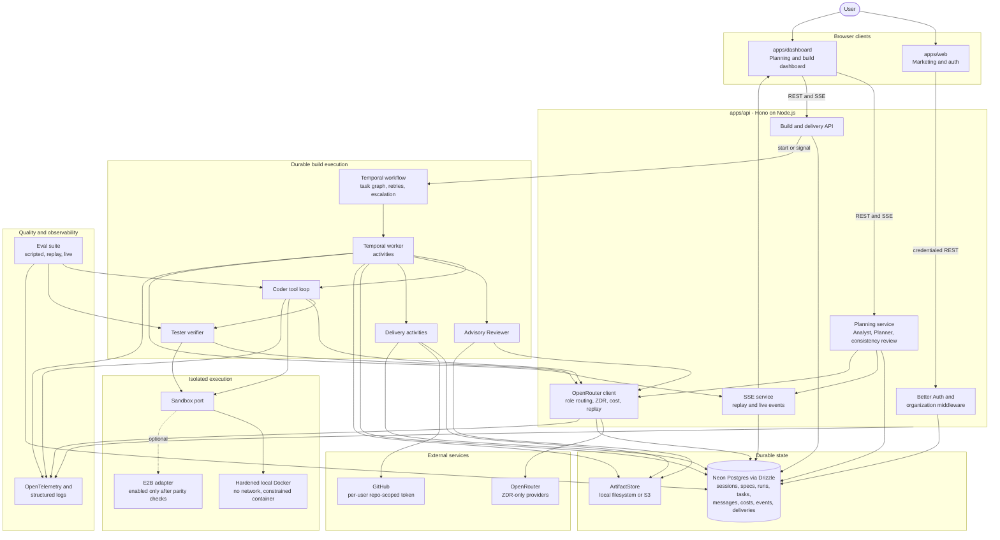

# Mullion

**Turn a one-line idea into a reviewable technical blueprint, or a finished working codebase. And watch the planning happen instead of waiting on a black box.**

You describe what you want to build. An Analyst agent asks a short, capped round of multiple-choice questions to clear up anything ambiguous. A Planner agent then designs the system live, in front of you. An architecture diagram and a decision log build up in real time, and you can interrupt in plain language at any point ("use Postgres instead", "add rate limiting"). When you confirm the architecture, you pick your exit:

- **Take the specs.** Walk away with the full set of design documents and hand them to your own team.
- **Let it build.** A pipeline of Coder, Tester, Reviewer, and DevOps agents implements, tests, and reviews the whole thing on its own. It only pulls you in for a small decision (approve, redirect, or abandon) if it gets truly stuck. At the end you get a downloadable archive and/or a push to your own GitHub repo.

```
Idea -> Clarify (capped MCQ) -> Plan (live, editable) -> Confirm
     -> Fork A: export specs      -> Fork B: automated build -> Deliver
```

## Why it exists

Fully autonomous coding agents work, but they are opaque. You hand over a ticket and get a PR back. Assistive tools are the opposite: you review every line, which does not scale to "build me a whole thing." Mullion sits in between. The planning is visible and steerable, like working with a person. And the engineering underneath is built to a production bar: durable execution that survives a crash mid-build, real sandbox isolation for generated code, hard cost limits, and a replayable trace of every decision. Partial and abandoned builds get the same delivery options as full successes, so you always leave with something.

## How it's built

| Concern | Choice |
|---|---|
| Frontend | Next.js 16 / React 19, TanStack Query, React Flow for live graphs |
| API | Hono on a persistent Node.js process, Better Auth (multi-tenant orgs), SSE for live streams |
| LLM access | OpenRouter only. Role-to-model routing lives in the DB, ZDR-only providers, cost recorded per call |
| Durable orchestration | Temporal. The build state machine survives crashes and replays deterministically |
| Untrusted code execution | Hardened Docker sandbox (no network, read-only rootfs, all capabilities dropped). E2B fits behind the same interface |
| Data | Postgres (Neon) via Drizzle. Artifacts on local disk or S3 behind one interface |
| Cost safety | Combined LLM + sandbox budgets per run and per org, enforced as a circuit breaker |
| Observability | OpenTelemetry end to end, including inside Temporal workflows |

Every external service has a local or fake driver picked by config. The whole system runs on a laptop with just Postgres, Docker, and a Temporal dev server. Real OpenRouter, E2B, S3, or GitHub credentials are optional swaps, not requirements.

## Architecture



## Monorepo map

Turborepo + pnpm workspaces. Each package has its own README with the technical detail.

| Path | What |
|---|---|
| [`apps/web`](apps/web) | Next.js frontend: intake, MCQ, live planning canvas, build view, delivery |
| [`apps/api`](apps/api) | Hono HTTP API + Temporal build-worker process |
| [`packages/agents`](packages/agents) | Agent roles (Analyst, Planner, Coder, Tester, Reviewer) + the tool-loop build runner |
| [`packages/orchestrator`](packages/orchestrator) | Temporal workflow + activities: the durable build state machine |
| [`packages/llm`](packages/llm) | The single OpenRouter integration: role routing, ZDR enforcement, cost capture, record/replay |
| [`packages/sandbox`](packages/sandbox) | Provider-agnostic sandbox interface. Hardened local Docker driver, E2B stub |
| [`packages/artifacts`](packages/artifacts) | Durable store for the files a build produces (local disk or S3) |
| [`packages/delivery`](packages/delivery) | Zip archive + GitHub repo push |
| [`packages/db`](packages/db) | Drizzle schema, migrations, pooled client |
| [`packages/schemas`](packages/schemas) | Shared Zod contracts: API, agents, build spec |
| [`packages/evals`](packages/evals) | Eval harness: build-quality metrics per system version |
| [`packages/otel`](packages/otel) | Shared OpenTelemetry setup + span helpers |
| [`packages/config`](packages/config) | Env schema validated at boot, shared tsconfigs |

## Getting started

You need: Node 22+, pnpm 10, Postgres, Docker, and the [Temporal CLI](https://docs.temporal.io/cli) (`temporal server start-dev`).

```bash
pnpm install

# configure
cp apps/api/.env.example apps/api/.env       # DATABASE_URL, BETTER_AUTH_SECRET, OPENROUTER_API_KEY, ...
cp apps/web/.env.example apps/web/.env.local # NEXT_PUBLIC_API_URL

# database
pnpm --filter @mullion/db db:migrate

# run (three terminals)
temporal server start-dev
pnpm --filter @mullion/api dev       # API on :8787
pnpm --filter @mullion/api worker    # Temporal build worker
pnpm --filter web dev                # web on :3000
```

The full list of env vars (sandbox driver, artifact store, budgets, GitHub delivery, and more) lives in [`packages/config/src/env.ts`](packages/config/src/env.ts). Every setting is documented inline, and a bad config fails at boot instead of at runtime.

```bash
pnpm build / dev / lint / check-types / test   # turbo across the workspace
pnpm --filter @mullion/evals evals             # build-quality eval run
```

## Documentation

| Doc | For |
|---|---|
| [`docs/specs/00_project_overview.md`](docs/specs/00_project_overview.md) | Plain-language what and why |
| [`docs/specs/01_product_ux_flow_spec.md`](docs/specs/01_product_ux_flow_spec.md) | The user experience, phase by phase |
| [`docs/specs/02_system_architecture_spec.md`](docs/specs/02_system_architecture_spec.md) | Services, schemas, agents. The implementation reference |
| [`docs/specs/04_design_decisions_log.md`](docs/specs/04_design_decisions_log.md) | Every ADR and why |
| [`docs/specs/05_build_plan.md`](docs/specs/05_build_plan.md) | The five build phases |
| [`docs/progress-tracker.md`](docs/progress-tracker.md) | What's actually built (v1 is feature-complete) |
| [`docs/CODING_STANDARDS.md`](docs/CODING_STANDARDS.md) | Conventions for anyone writing code here |

## Status

v1 is feature-complete: all five build phases done and verified, with a security review at the end of each phase. Verification against live credentials (real OpenRouter key, E2B, Temporal Cloud, GitHub OAuth) is still pending. Everything is verified against the local and mock drivers. Details in the [progress tracker](docs/progress-tracker.md).
